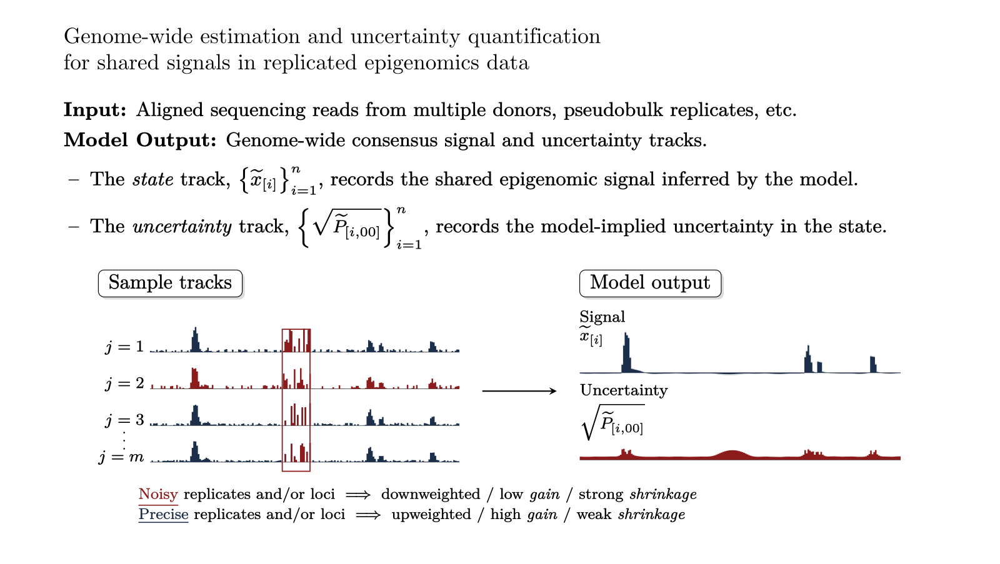

# Consenrich

Consenrich provides estimation and uncertainty quantification for a shared latent regulatory signal using multi-sample epigenomic sequencing measurements.

<a id="consenrich-overview">
  
</a>

[**See the Documentation**](https://nolan-h-hamilton.github.io/Consenrich/).


## Manuscript Preprint and Citation

**BibTeX Citation**

```bibtex
@article {Hamilton2025,
	author = {Hamilton, Nolan H and Huang, Yu-Chen E and McMichael, Benjamin D and Love, Michael I and Furey, Terrence S},
	title = {Genome-Wide Uncertainty-Moderated Extraction of Signal Annotations from Multi-Sample Functional Genomics Data},
	year = {2025},
	doi = {10.1101/2025.02.05.636702},
	publisher = {Cold Spring Harbor Laboratory},
	journal = {bioRxiv}
}
```
