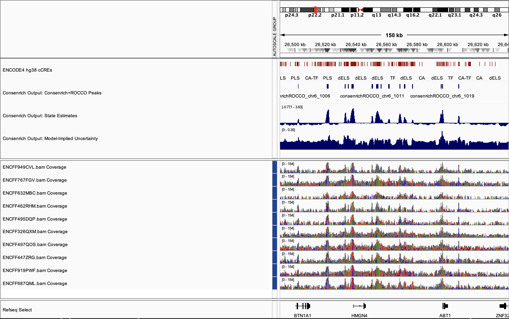
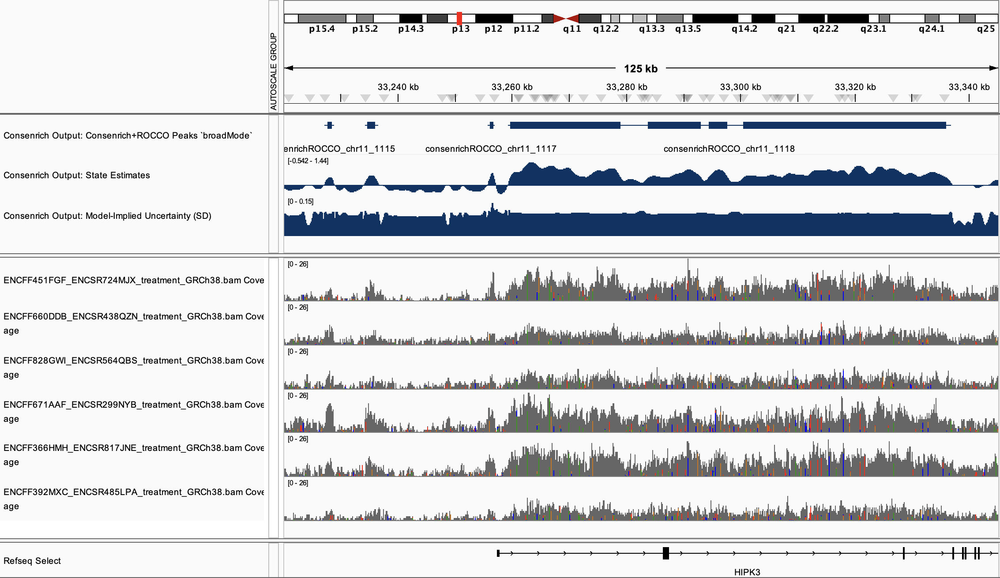
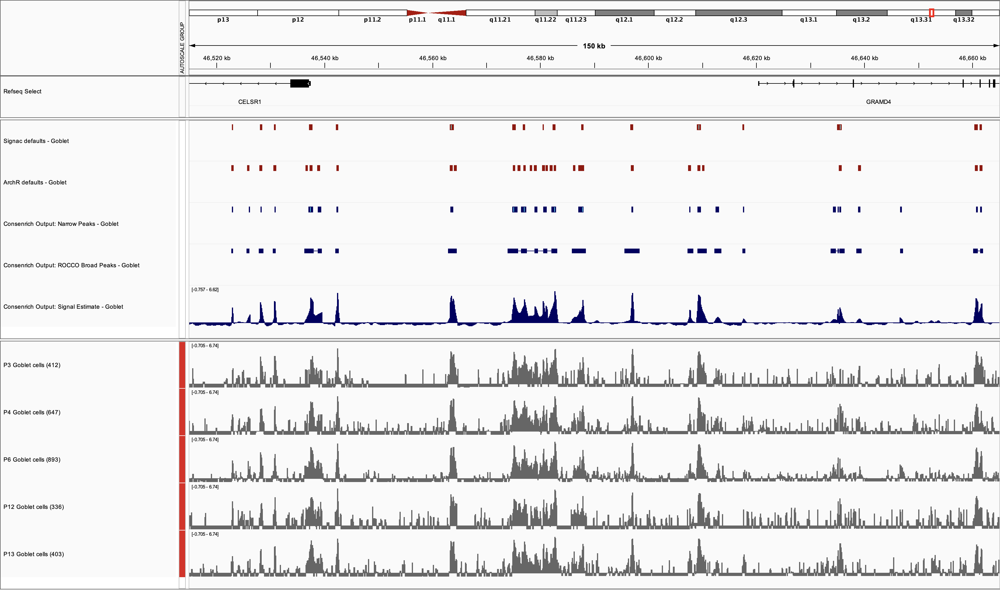
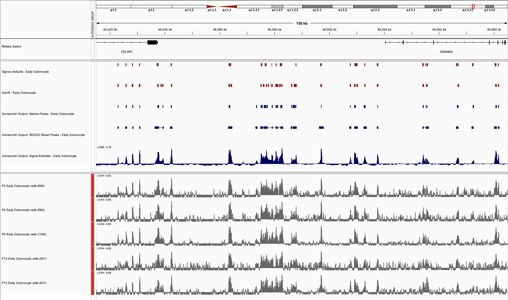
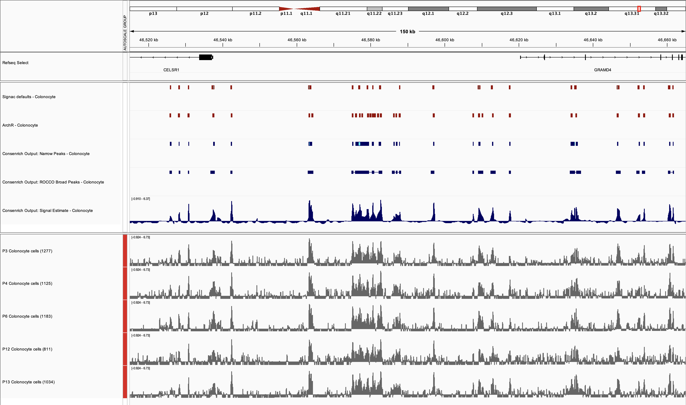
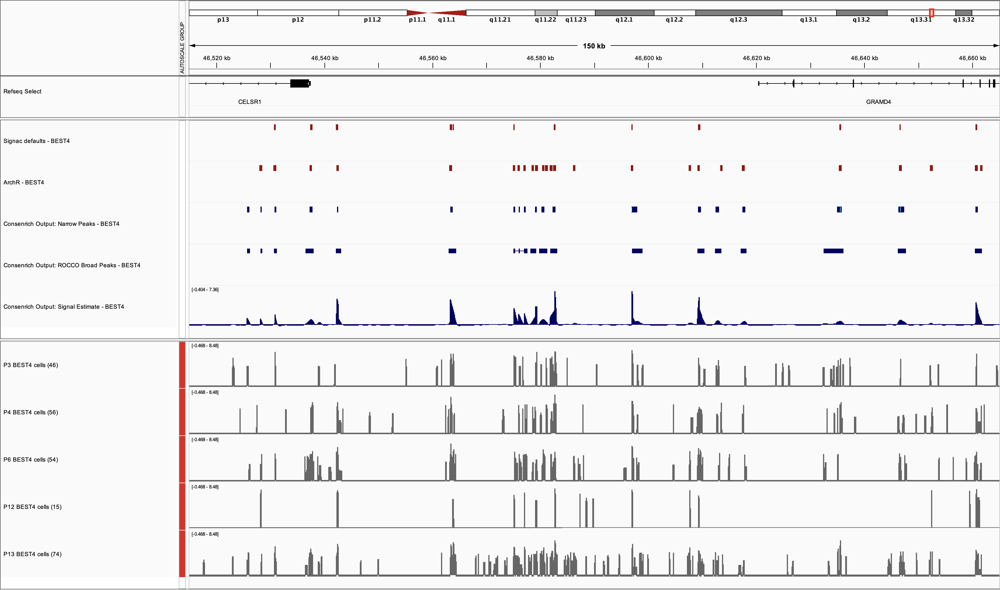

Quickstart + Usage
------------------

After installing Consenrich, run it from the command line with
``consenrich -h`` for usage or programmatically as a Python import.

.. _getting-started:

Getting Started: H3K27ac ChIP-seq
~~~~~~~~~~~~~~~~~~~~~~~~~~~~~~~~~

This minimal example estimates a consensus from *four* ENCODE
epidermis ChIP-seq experiments with matched input controls.

Input Data
""""""""""

.. list-table:: H3K27ac demo inputs
  :header-rows: 1
  :widths: 18 22 30 30

  * - Experiment
    - Biosample
    - H3K27ac alignment
    - Control alignment
  * - `ENCSR214UZE <https://www.encodeproject.org/experiments/ENCSR214UZE/>`_
    - Epidermis/Female/71
    - `ENCFF793ZHL.bam <https://www.encodeproject.org/files/ENCFF793ZHL/@@download/ENCFF793ZHL.bam>`_
    - `ENCFF444WVG.bam <https://www.encodeproject.org/files/ENCFF444WVG/@@download/ENCFF444WVG.bam>`_
  * - `ENCSR334DRN <https://www.encodeproject.org/experiments/ENCSR334DRN/>`_
    - Epidermis/Male/67
    - `ENCFF647VPO.bam <https://www.encodeproject.org/files/ENCFF647VPO/@@download/ENCFF647VPO.bam>`_
    - `ENCFF619NYP.bam <https://www.encodeproject.org/files/ENCFF619NYP/@@download/ENCFF619NYP.bam>`_
  * - `ENCSR340ZTB <https://www.encodeproject.org/experiments/ENCSR340ZTB/>`_
    - Epidermis/Female/80
    - `ENCFF809VKT.bam <https://www.encodeproject.org/files/ENCFF809VKT/@@download/ENCFF809VKT.bam>`_
    - `ENCFF898LKJ.bam <https://www.encodeproject.org/files/ENCFF898LKJ/@@download/ENCFF898LKJ.bam>`_
  * - `ENCSR386CKJ <https://www.encodeproject.org/experiments/ENCSR386CKJ/>`_
    - Epidermis/Male/75
    - `ENCFF295EFL.bam <https://www.encodeproject.org/files/ENCFF295EFL/@@download/ENCFF295EFL.bam>`_
    - `ENCFF490MWV.bam <https://www.encodeproject.org/files/ENCFF490MWV/@@download/ENCFF490MWV.bam>`_

Download Alignments
"""""""""""""""""""

Copy and paste the following into your terminal to download and index the BAM
files. You can use ``curl -L -O <URL>`` in place of ``wget <URL>`` if ``wget``
is not available.

.. code-block:: bash

  encodeFiles=https://www.encodeproject.org/files
  for file in ENCFF793ZHL ENCFF647VPO ENCFF809VKT ENCFF295EFL; do
      wget "$encodeFiles/$file/@@download/$file.bam"
  done
  for ctrl in ENCFF444WVG ENCFF619NYP ENCFF898LKJ ENCFF490MWV; do
      wget "$encodeFiles/$ctrl/@@download/$ctrl.bam"
  done
  samtools index -M *.bam

YAML Configuration
""""""""""""""""""

Save the following as ``demoHistoneChIPSeq.yaml`` in the directory containing
the BAM files:

.. code-block:: yaml
  :name: demoHistoneChIPSeq.yaml

  experimentName: demoHistoneChIPSeq

  genomeParams:
    name: hg38
    chromosomes: [chr21, chr22]
    excludeForNorm: [chrX, chrY]

  inputParams:
    samples:
      - name: H3K27ac_1
        path: ENCFF793ZHL.bam
        format: bam
        role: treatment
      - name: H3K27ac_2
        path: ENCFF647VPO.bam
        format: bam
        role: treatment
      - name: H3K27ac_3
        path: ENCFF809VKT.bam
        format: bam
        role: treatment
      - name: H3K27ac_4
        path: ENCFF295EFL.bam
        format: bam
        role: treatment
      - name: input_1
        path: ENCFF444WVG.bam
        format: bam
        role: control
      - name: input_2
        path: ENCFF619NYP.bam
        format: bam
        role: control
      - name: input_3
        path: ENCFF898LKJ.bam
        format: bam
        role: control
      - name: input_4
        path: ENCFF490MWV.bam
        format: bam
        role: control

Run Consenrich
""""""""""""""

.. code-block:: console
  :name: Run H3K27ac demo

  % consenrich --config demoHistoneChIPSeq.yaml --verbose

The run writes a state bedGraph, uncertainty bedGraph, state bigWig,
uncertainty bigWig, ROCCO narrowPeak file, and ROCCO gappedPeak file. With the
current package version, the principal output files are:

.. code-block:: text

  demoHistoneChIPSeq_consenrich_state.VERSION.bw
  demoHistoneChIPSeq_consenrich_uncertainty.VERSION.bw
  consenrichOutput_demoHistoneChIPSeq_state.VERSION_rocco.narrowPeak
  consenrichOutput_demoHistoneChIPSeq_state.VERSION_rocco.gappedPeak
  consenrichOutput_demoHistoneChIPSeq_state.VERSION_rocco.narrowPeak.nullCalibration.png

.. _atac-demo:

ATAC-seq Demo
~~~~~~~~~~~~~

This demo estimates a consensus chromatin accessibility signal from *ten* ENCODE
ATAC-seq alignments.

Download Alignments
"""""""""""""""""""

.. code-block:: bash

  encodeFiles=https://www.encodeproject.org/files
  for file in ENCFF326QXM ENCFF447ZRG ENCFF462RHM ENCFF495DQP ENCFF497QOS ENCFF632MBC ENCFF687QML ENCFF767FGV ENCFF919PWF ENCFF949CVL; do
      wget "$encodeFiles/$file/@@download/$file.bam"
  done
  samtools index -M *.bam

YAML Configuration
""""""""""""""""""

Save the following as ``atacDemo.yaml``:

.. code-block:: yaml
  :name: atacDemo.yaml

  experimentName: atacDemo

  genomeParams:
    name: hg38
    # chromosomes: [chr11, chr22] # faster: Uncomment and specify chromosomes
    excludeForNorm: [chrX, chrY]

  inputParams:
    bamFiles:
      - ENCFF326QXM.bam
      - ENCFF447ZRG.bam
      - ENCFF462RHM.bam
      - ENCFF495DQP.bam
      - ENCFF497QOS.bam
      - ENCFF632MBC.bam
      - ENCFF687QML.bam
      - ENCFF767FGV.bam
      - ENCFF919PWF.bam
      - ENCFF949CVL.bam

Run Consenrich
""""""""""""""

.. code-block:: console
  :name: Run ATAC demo

  % consenrich --config atacDemo.yaml --verbose

Results
"""""""

Broad Mark ChIP-seq Demo
~~~~~~~~~~~~~~~~~~~~~~~~

This demo estimates a consensus H3K4me1 signal from *six* ENCODE ChIP-seq experiments with matched input controls.

Download Alignments
"""""""""""""""""""

.. code-block:: bash

  encodeFiles=https://www.encodeproject.org/files

  while read -r accession output; do
      wget -O "$output" "$encodeFiles/$accession/@@download/$accession.bam"
  done <<'EOF'
  ENCFF451FGF ENCFF451FGF_ENCSR724MJX_treatment_GRCh38.bam
  ENCFF660DDB ENCFF660DDB_ENCSR438QZN_treatment_GRCh38.bam
  ENCFF828GWI ENCFF828GWI_ENCSR564QBS_treatment_GRCh38.bam
  ENCFF671AAF ENCFF671AAF_ENCSR299NYB_treatment_GRCh38.bam
  ENCFF366HMH ENCFF366HMH_ENCSR817JNE_treatment_GRCh38.bam
  ENCFF392MXC ENCFF392MXC_ENCSR485LPA_treatment_GRCh38.bam
  ENCFF013ION ENCFF013ION_ENCSR109IWL_control_GRCh38.bam
  ENCFF730PAF ENCFF730PAF_ENCSR526EXI_control_GRCh38.bam
  ENCFF971XWL ENCFF971XWL_ENCSR945LPX_control_GRCh38.bam
  ENCFF271VZL ENCFF271VZL_ENCSR261PLD_control_GRCh38.bam
  ENCFF944AYC ENCFF944AYC_ENCSR061EXX_control_GRCh38.bam
  ENCFF273EYI ENCFF273EYI_ENCSR120ITZ_control_GRCh38.bam
  EOF

  samtools index -M *.bam

YAML Configuration
""""""""""""""""""

Save the following as ``bigH3K4me1Demo.yaml``:

.. code-block:: yaml
  :name: bigH3K4me1Demo.yaml

  experimentName: bigH3K4me1Demo

  genomeParams:
    name: hg38
    chromosomes: [chr21, chr22]
    excludeForNorm: [chrX, chrY]

  inputParams:
    samples:
      - name: ENCSR724MJX_H3K4me1
        path: ENCFF451FGF_ENCSR724MJX_treatment_GRCh38.bam
        format: bam
        role: treatment
      - name: ENCSR438QZN_H3K4me1
        path: ENCFF660DDB_ENCSR438QZN_treatment_GRCh38.bam
        format: bam
        role: treatment
      - name: ENCSR564QBS_H3K4me1
        path: ENCFF828GWI_ENCSR564QBS_treatment_GRCh38.bam
        format: bam
        role: treatment
      - name: ENCSR299NYB_H3K4me1
        path: ENCFF671AAF_ENCSR299NYB_treatment_GRCh38.bam
        format: bam
        role: treatment
      - name: ENCSR817JNE_H3K4me1
        path: ENCFF366HMH_ENCSR817JNE_treatment_GRCh38.bam
        format: bam
        role: treatment
      - name: ENCSR485LPA_H3K4me1
        path: ENCFF392MXC_ENCSR485LPA_treatment_GRCh38.bam
        format: bam
        role: treatment

      - name: ENCSR109IWL_input_for_ENCSR724MJX
        path: ENCFF013ION_ENCSR109IWL_control_GRCh38.bam
        format: bam
        role: control
      - name: ENCSR526EXI_input_for_ENCSR438QZN
        path: ENCFF730PAF_ENCSR526EXI_control_GRCh38.bam
        format: bam
        role: control
      - name: ENCSR945LPX_input_for_ENCSR564QBS
        path: ENCFF971XWL_ENCSR945LPX_control_GRCh38.bam
        format: bam
        role: control
      - name: ENCSR261PLD_input_for_ENCSR299NYB
        path: ENCFF271VZL_ENCSR261PLD_control_GRCh38.bam
        format: bam
        role: control
      - name: ENCSR061EXX_input_for_ENCSR817JNE
        path: ENCFF944AYC_ENCSR061EXX_control_GRCh38.bam
        format: bam
        role: control
      - name: ENCSR120ITZ_input_for_ENCSR485LPA
        path: ENCFF273EYI_ENCSR120ITZ_control_GRCh38.bam
        format: bam
        role: control

Run Consenrich
""""""""""""""

.. code-block:: console
  :name: Run H3K4me1 demo

  % consenrich --config bigH3K4me1Demo.yaml --verbose

Results
"""""""

.. _scatac-demo:

Consenrich for Single-Cell
~~~~~~~~~~~~~~~~~~~~~~~~~~~~~~~~

In this demo, we use publicly available scATAC-seq data to infer signal and peaks for Goblet, Early Colonocyte, Colonocyte, and BEST4 cells in the ascending colon. Note that Consenrich can also accept data from other single-cell epigenomic assays, e.g., scCut&Tag.

`Zhao/Pott <https://www.nature.com/articles/s41588-026-02755-z>`_
· `GSE273194 <https://www.ncbi.nlm.nih.gov/geo/query/acc.cgi?acc=GSE273194>`_
· `Cell annotations <https://zenodo.org/records/21508422>`_

.. list-table::
  :header-rows: 1
  :widths: 10 26 14 22 16 12

  * - Donor
    - GEO sample
    - Goblet
    - Early Colonocyte
    - Colonocyte
    - BEST4
  * - P3
    - `GSM8423799 <https://www.ncbi.nlm.nih.gov/geo/query/acc.cgi?acc=GSM8423799>`_
    - 412
    - 690
    - 1277
    - 46
  * - P4
    - `GSM8423800 <https://www.ncbi.nlm.nih.gov/geo/query/acc.cgi?acc=GSM8423800>`_
    - 647
    - 983
    - 1125
    - 56
  * - P6
    - `GSM8423801 <https://www.ncbi.nlm.nih.gov/geo/query/acc.cgi?acc=GSM8423801>`_
    - 893
    - 1355
    - 1183
    - 54
  * - P12
    - `GSM8423805 <https://www.ncbi.nlm.nih.gov/geo/query/acc.cgi?acc=GSM8423805>`_
    - 336
    - 591
    - 811
    - 15
  * - P13
    - `GSM8423806 <https://www.ncbi.nlm.nih.gov/geo/query/acc.cgi?acc=GSM8423806>`_
    - 403
    - 827
    - 1034
    - 74

Download Fragments and Cell Labels
""""""""""""""""""""""""""""""""""

This will be about 6 GB of data. You can remove donors and adapt the YAML config below as needed to reduce size.

.. code-block:: bash

  geoFiles=https://ftp.ncbi.nlm.nih.gov/geo/samples/GSM8423nnn

  while read -r accession donor; do
      fragmentFile="${accession}_${donor}-AC-CDnonInf_fragments.tsv.gz"
      curl -fLO "$geoFiles/$accession/suppl/$fragmentFile"
      curl -fLO "$geoFiles/$accession/suppl/$fragmentFile.tbi.gz"
      gzip -dc "$fragmentFile.tbi.gz" > "$fragmentFile.tbi"
  done <<'EOF'
  GSM8423799 P3
  GSM8423800 P4
  GSM8423801 P6
  GSM8423805 P12
  GSM8423806 P13
  EOF

  # wget or curl, depending
  curl -fL -o scATAC_cell_metadata.csv \
      'https://zenodo.org/records/21508422/files/scATAC_cell_metadata.csv?download=1'

YAML Configuration
""""""""""""""""""

.. code-block:: yaml
  :name: scATACDemo.yaml

  experimentName: scATACDemo

  genomeParams:
    name: hg38
    chromosomes: [chr21, chr22] # delete this line to run genome-wide

  scParams:
    cellMetadata:
      path: scATAC_cell_metadata.csv
      barcodeColumn: barcode
      sampleColumn: Sample_ID
      groupColumn: cluster_label1
    fits:
      - name: Goblet
        selectGroups: [AC_Goblet]
      - name: EarlyColonocyte
        selectGroups: [Early_Colonocyte]
      - name: Colonocyte
        selectGroups: [Colonocyte]
      - name: BEST4
        selectGroups: [BEST4]

  inputParams:
    samples:
      - name: P3
        path: GSM8423799_P3-AC-CDnonInf_fragments.tsv.gz
        format: fragments
        metadataSample: P3-AC-CDnonInf
      - name: P4
        path: GSM8423800_P4-AC-CDnonInf_fragments.tsv.gz
        format: fragments
        metadataSample: P4-AC-CDnonInf
      - name: P6
        path: GSM8423801_P6-AC-CDnonInf_fragments.tsv.gz
        format: fragments
        metadataSample: P6-AC-CDnonInf
      - name: P12
        path: GSM8423805_P12-AC-CDnonInf_fragments.tsv.gz
        format: fragments
        metadataSample: P12-AC-CDnonInf
      - name: P13
        path: GSM8423806_P13-AC-CDnonInf_fragments.tsv.gz
        format: fragments
        metadataSample: P13-AC-CDnonInf

Run Consenrich
""""""""""""""

.. code-block:: console

  % consenrich --config scATACDemo.yaml --verbose

.. _scatac-results:

Results
"""""""

Browser snapshots for each cell type (uncertainty tracks omitted for spacing)

Goblet
^^^^^^

Early Colonocyte
^^^^^^^^^^^^^^^^

Colonocyte
^^^^^^^^^^

BEST4
^^^^^

