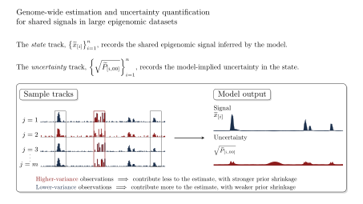

Consenrich
===========================

.. toctree::
   :maxdepth: 1
   :caption: Contents
   :name: Consenrich Homepage
   :hidden:

   Home <self>
   installation
   examples
   params
   genome
   api

Bulk and single-cell data are supported for common chromatin acessibility, transcription factor binding, and histone PTM assays.

.. list-table::
   :widths: 40 50
   :header-rows: 1

   * - Resource
     - Link
   * - Manuscript Preprint
     - `bioRxiv <https://www.biorxiv.org/content/10.1101/2025.02.05.636702v3>`_
   * - Source Code
     - `GitHub <https://github.com/nolan-h-hamilton/Consenrich>`_
   * - Documentation, examples, etc.
     - `(This site) <https://nolan-h-hamilton.github.io/Consenrich/>`_
   * - Contact
     - Nolan [dot] Hamilton <at> unc [dot] edu
